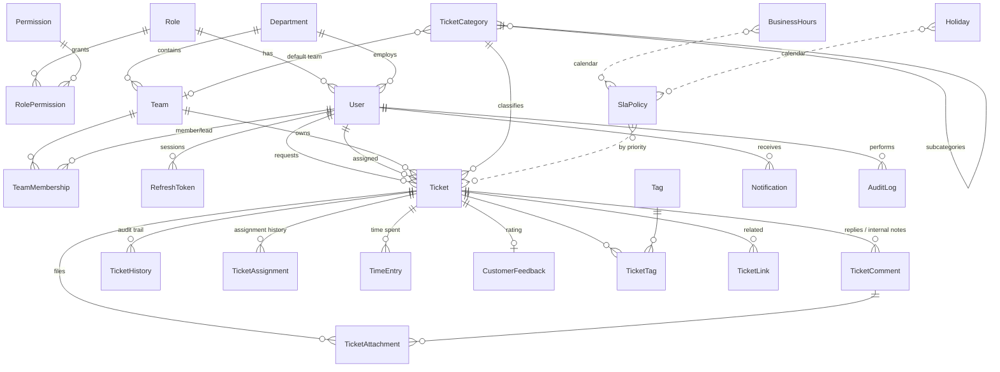

# Support Desk — Ticket Management System

A production-oriented ticket management system for customer issues, technical support requests, internal tasks and incident reports.

| Layer | Stack |
| --- | --- |
| Frontend | React 18, TypeScript, Vite, Tailwind CSS, shadcn-style components (Radix UI), TanStack Query, React Hook Form + Zod, Recharts, Lucide |
| Backend | Node.js 22, Express, TypeScript, Zod validation, Swagger/OpenAPI (generated from route definitions), Pino structured logs |
| Data | PostgreSQL 16, Prisma ORM and migrations |
| Auth | JWT access token + rotating refresh token in **HttpOnly cookies**, double-submit CSRF, Argon2id password hashing |
| Testing | Vitest + Supertest (API integration against a real PostgreSQL database), Vitest + Testing Library (web) |
| Delivery | Dockerfiles, Docker Compose, nginx, GitHub Actions CI |

---

## Contents

1. [Features](#features)
2. [Architecture](#architecture)
3. [Database design](#database-design)
4. [Project structure](#project-structure)
5. [Getting started (development)](#getting-started-development)
6. [Development credentials](#development-credentials-development-only)
7. [Commands](#commands)
8. [Production deployment (Docker)](#production-deployment-docker)
9. [Configuration](#configuration)
10. [API](#api)
11. [Security](#security)
12. [SLA semantics](#sla-semantics)
13. [Testing](#testing)
14. [Troubleshooting](#troubleshooting)
15. [Implementation checklist](#implementation-checklist)

---

## Features

**Roles** (stored in the database and editable; the API only ever checks *permissions*):

| Role | Highlights |
| --- | --- |
| Super Admin | Everything: users, roles & permissions, departments/teams/categories/tags, SLA, system settings, audit log, all tickets and reports |
| Support Manager | Tickets of their teams, assignment, priority changes, escalation, bulk updates, reopening, team reports |
| Support Agent | Tickets of their teams or assigned to them, accept, status changes, public replies & internal notes, attachments, resolution notes, time tracking |
| Customer | Create and track own tickets, reply, attach files, reopen resolved tickets within a window, rate support |

**Tickets** have a configurable number (e.g. `TKT-2026-00001`), subject, description, requester, assignee, team, category/subcategory, priority, a 7-state status workflow, source, due date, SLA deadlines, tags, attachments, resolution notes, related tickets, a full timestamped history, and CSAT feedback. You can search, filter (status, priority, agent, team, category, date range, overdue, SLA breached), sort, paginate, bulk-assign, bulk-update status or priority (all-or-nothing), escalate and reopen.

**Conversation**: public replies and internal notes are visually distinct. Internal notes, internal attachments, internal history entries and time tracking are never returned to customers by any endpoint.

**SLA**: per-priority first-response and resolution targets in business hours (working days, hours, holidays and time zone) or 24×7. SLA time pauses while a ticket waits on the customer. A background monitor sends warnings at a configurable threshold, records breaches and auto-escalates. Resolved tickets are auto-closed after a grace period.

**Notifications**: in-app notifications with unread counts for creation, assignment, priority changes, replies, status changes, SLA warnings and breaches, escalation, resolution, closure and reopening. Email goes out over SMTP when configured, through a pluggable channel interface.

**Dashboards and reports**: role-based dashboards, plus volume by day, week or month; distribution by priority, status, category, source and team; agent workload and performance; team resolution times; first-response and SLA compliance; reopen rates; CSAT. All of these support date-range filters and CSV export, and every figure comes from SQL aggregates restricted to the caller's data scope.

**UI**: responsive (desktop, tablet, mobile), light and dark mode, sortable/filterable tables, searchable dropdowns, confirmation dialogs, toasts, skeleton loaders, empty and error states, and client- plus server-side validation.

---

## Architecture

```
Browser ──► nginx (web container) ──► /api/* ──► Express API ──► PostgreSQL
            │ serves SPA (same origin)            │
            │                                     ├── Storage driver (local volume | S3-compatible)
            │                                     ├── Notification channels (in-app | SMTP)
            │                                     └── SLA monitor (interval job, advisory-locked)
```

**Backend layering** (`apps/api/src`):

- **Routes** (`modules/*/*.routes.ts`) are thin. Each endpoint is declared once with `defineRoute()`, which wires authentication, permission checks, Zod validation of params, query and body, async error forwarding, *and* the OpenAPI documentation. Code and docs cannot drift.
- **Services** (`modules/*/*.service.ts`, `services/*`) hold the business logic: ticket workflow, assignment, SLA computation, notifications, storage, settings and audit.
- **Pure domain logic** is isolated and unit-tested: the status state machine (`tickets/workflow.ts`), business-time math (`sla/businessTime.ts`) and numbering.
- **Data access scope** is defined once (`tickets/scope.ts`, with a SQL twin in `reports.service.ts`) and applied to lists, details, actions, attachments, activity feeds and reports.
- **Atomicity**: every ticket mutation runs in a transaction that row-locks the ticket (`SELECT … FOR UPDATE`). History, assignment records and notifications commit together, and external email is dispatched only after commit. Ticket numbers come from an atomic `INSERT … ON CONFLICT DO UPDATE … RETURNING` counter.

**Frontend** (`apps/web/src`): feature folders (`features/*`), reusable UI primitives (`components/ui`), a typed fetch client (`lib/api.ts`) that handles CSRF and silent refresh, React Query for server state, and filters synced to the URL. Each ticket response carries a server-computed `capabilities` object, so the UI shows exactly the actions the API will accept. The API still enforces every rule independently.

---

## Database design



Further tables: `TicketCounter` (numbering) and `SystemSetting` (key/value configuration validated by Zod).

Design rules:

- **No hard deletes of important records.** Users, teams, departments and categories are *deactivated*. Tickets are never deleted (an `archivedAt` column exists for future archiving). Attachments are soft-deleted. Foreign keys from history, comments, attachments and assignments to tickets and users use `ON DELETE RESTRICT`. Only pure join/child rows cascade.
- **Indexes** on every foreign key used in filters, plus `(status, resolutionDueAt)` for SLA scans, `(ticketId, createdAt)` for timelines, `(userId, readAt)` for unread counts, and `lower(subject)`.
- **Integrity constraints** that Prisma can't express live in a SQL migration: rating 1–5, positive time entries, a valid business-hours window, sane SLA targets, and no self-links.

---

## Project structure

```
.
├── apps/
│   ├── api/
│   │   ├── prisma/
│   │   │   ├── schema.prisma          # data model
│   │   │   ├── migrations/            # SQL migrations (incl. CHECK constraints)
│   │   │   └── seed.ts                # reference data + dev sample data / prod admin bootstrap
│   │   ├── src/
│   │   │   ├── app.ts / server.ts     # Express app, startup & graceful shutdown
│   │   │   ├── config/env.ts          # Zod-validated environment
│   │   │   ├── docs/openapi.ts        # OpenAPI document (paths registered by defineRoute)
│   │   │   ├── jobs/slaMonitor.ts     # SLA warnings/breaches/escalation/auto-close
│   │   │   ├── lib/                   # route helper, errors, tokens, cookies, password, prisma, logger
│   │   │   ├── middleware/            # authenticate, CSRF, rate limits, error handler
│   │   │   ├── modules/
│   │   │   │   ├── auth/              # login, refresh, register, profile, permission catalogue
│   │   │   │   ├── users/ roles/ org/ # administration
│   │   │   │   ├── tickets/           # scope, workflow, numbering, services, routes
│   │   │   │   ├── sla/               # business-time engine, policies, hours, holidays
│   │   │   │   ├── reports/           # scoped SQL analytics + CSV export
│   │   │   │   └── notifications/ settings/ audit/
│   │   │   └── services/              # audit, settings, bootstrap, notifications, storage
│   │   ├── tests/                     # unit + integration tests, factories, DB reset helper
│   │   └── Dockerfile
│   └── web/
│       ├── src/
│       │   ├── components/ui/         # Button, Dialog, Select, Combobox, Table, Tabs, …
│       │   ├── components/{layout,tickets,charts}/
│       │   ├── features/              # auth, dashboard, tickets, reports, admin, notifications, profile
│       │   ├── hooks/                 # useAuth, useTheme, lookups, settings
│       │   ├── lib/                   # api client, types, utils, validation
│       │   └── test/                  # web unit/component tests
│       ├── nginx.conf
│       └── Dockerfile
├── docker-compose.yml                 # production-style stack (db + api + web)
├── docker-compose.dev.yml             # PostgreSQL for local development
├── .github/workflows/ci.yml
└── .env.example                       # Compose configuration template
```

---

## Getting started (development)

**Prerequisites:** Node.js ≥ 20 (22 recommended), npm ≥ 10, PostgreSQL 16 (local install or Docker).

```bash
# 1. Install dependencies (npm workspaces)
npm install

# 2. Start PostgreSQL (or use your own server; see apps/api/.env.example)
docker compose -f docker-compose.dev.yml up -d     # creates ticket_dev and ticket_test

# 3. Configure the API
cp apps/api/.env.example apps/api/.env              # defaults match docker-compose.dev.yml

# 4. Create the schema and load development data
npm run db:migrate                                  # prisma migrate dev
npm run db:seed

# 5. Run (two terminals)
npm run dev:api                                     # http://localhost:4000  (Swagger: /api/docs)
npm run dev:web                                     # http://localhost:5173  (proxies /api → :4000)
```

Using your own PostgreSQL? Create a role and two databases (`ticket_dev`, `ticket_test`) and point `DATABASE_URL` at the first.

## Development credentials (development only)

The development seed creates sample departments, teams, categories, tags, holidays and about 140 realistic tickets with full lifecycles. Every seeded account uses the password **`Password123!`**:

| Role | Email |
| --- | --- |
| Super Admin | `admin@example.com` |
| Support Manager | `manager@example.com` (also `it.manager@example.com`) |
| Support Agent | `agent@example.com` (plus 5 more agents) |
| Customer | `customer@example.com` (plus 7 more customers) |

> ⚠️ **These credentials exist only in development data.** With `NODE_ENV=production` the seed creates **no** sample data. It creates a single Super Admin from `ADMIN_EMAIL`/`ADMIN_PASSWORD`, which must satisfy the password policy. The API refuses to start in production with a placeholder `JWT_ACCESS_SECRET`.

---

## Commands

| Command | What it does |
| --- | --- |
| `npm run dev:api` / `npm run dev:web` | Run API (tsx watch) / web (Vite) in development |
| `npm run build` | Build API (tsup → `apps/api/dist`) and web (→ `apps/web/dist`) |
| `npm test` | API tests (unit + integration on `ticket_test`) and web tests |
| `npm run lint` | Type-check both apps |
| `npm run db:migrate` | Create/apply migrations in development |
| `npm run db:seed` | Seed reference + development data (skips sample data if tickets exist) |
| `npm run db:deploy -w apps/api` | Apply migrations non-destructively (production/CI) |
| `npm start -w apps/api` | Run the built API |

---

## Production deployment (Docker)

```bash
cp .env.example .env
# Set POSTGRES_PASSWORD, JWT_ACCESS_SECRET (openssl rand -base64 48), APP_URL, ADMIN_EMAIL, ADMIN_PASSWORD
docker compose up -d --build
# open http://localhost:8080 (or your APP_URL)
```

What the stack does:

- `db`: PostgreSQL 16 on a private network only (no published port), data in a named volume, UTC time zone.
- `api`: on start it runs `prisma migrate deploy` (non-destructive), then creates the first Super Admin if `ADMIN_EMAIL`/`ADMIN_PASSWORD` are set and the account doesn't exist yet. It runs as the unprivileged `node` user behind an init process, with a health check, and stores attachments in a volume.
- `web`: nginx serves the SPA and proxies `/api` to the API, so everything is same-origin, with security headers (CSP, frame denial, nosniff, referrer policy) and immutable caching for hashed assets.

Production checklist:

- **Terminate TLS** in front of the `web` service (load balancer or reverse proxy) and serve over HTTPS. Cookies are `Secure` in production, and browsers only send them over HTTPS, except on `localhost`.
- Set `APP_URL` to the public origin. It drives the CORS allow-list and links in emails.
- For S3 attachments set `STORAGE_DRIVER=s3` and the `S3_*` variables (works with AWS S3, MinIO, R2 and similar). Objects are written with server-side encryption.
- To enable email notifications set `SMTP_*`. Any SMTP server or transactional provider relay works (SES, SendGrid, Postmark, Mailgun).
- Back up the `pgdata` volume (or use a managed PostgreSQL) and the attachments volume or bucket.
- Run multiple API replicas if needed. The SLA monitor uses a PostgreSQL advisory lock, so only one instance processes a run. Note that rate-limit counters are kept in memory per instance.

---

## Configuration

API environment variables (validated at startup; see `apps/api/.env.example`):

| Variable | Default | Purpose |
| --- | --- | --- |
| `DATABASE_URL` | — | PostgreSQL connection string |
| `JWT_ACCESS_SECRET` | — | ≥ 32 chars; placeholder values are rejected in production |
| `ACCESS_TOKEN_TTL_MINUTES` / `REFRESH_TOKEN_TTL_DAYS` | 15 / 7 | Session lifetimes |
| `CORS_ORIGINS`, `APP_URL`, `TRUST_PROXY` | | Origins, public URL, proxy awareness |
| `LOGIN_MAX_ATTEMPTS`, `LOGIN_LOCK_MINUTES` | 5 / 15 | Account lockout |
| `STORAGE_DRIVER` (`local`/`s3`), `STORAGE_LOCAL_DIR`, `S3_*` | local | Attachment storage |
| `MAX_UPLOAD_MB` | 10 | Hard per-file ceiling (the admin setting can lower it) |
| `SMTP_*`, `EMAIL_FROM` | disabled | Email delivery |
| `SLA_MONITOR_ENABLED`, `SLA_MONITOR_INTERVAL_SECONDS` | true / 60 | Background SLA job |

Runtime settings (admin UI → *System settings*): organization name, time zone, ticket number prefix/digits/year, self-registration, reopen window, auto-close delay, email on/off, allowed attachment types and size.

---

## API

- Swagger UI: **`/api/docs`**. OpenAPI JSON: **`/api/openapi.json`**. Every endpoint is documented with its parameters, body schema, required permissions and error codes. To try requests in Swagger UI, call `GET /api/auth/csrf` and `POST /api/auth/login` first; the CSRF header is then attached automatically.
- Success envelope: `{ "data": …, "meta"?: { page, pageSize, total, totalPages } }`. Error envelope: `{ "error": { "code", "message", "details"? } }`.
- Status codes: `400` bad request, `401` unauthenticated, `403` forbidden or CSRF, `404` not found (also used for records outside your scope, so existence isn't revealed), `409` conflict, `413` too large, `422` validation or invalid transition, `423` locked account, `429` rate limited.
- Endpoint groups: `/api/auth`, `/api/users`, `/api/roles`, `/api/departments`, `/api/teams`, `/api/categories`, `/api/tags`, `/api/tickets` (with `/comments`, `/attachments`, `/history`, `/time-entries`, `/links`, `/status`, `/assign`, `/accept`, `/priority`, `/escalate`, `/reopen`, `/feedback`, `/bulk`), `/api/sla`, `/api/notifications`, `/api/reports`, `/api/settings`, `/api/audit-logs`, `/api/health`.

---

## Security

- **Passwords**: Argon2id (m = 19 MiB, t = 2, p = 1). Policy: 10+ characters with upper case, lower case and a digit. Unknown-email logins spend equal hashing time, so response timing doesn't reveal accounts.
- **Sessions**: a short-lived access JWT (HS256, issuer and audience checked) and an opaque refresh token, both in `HttpOnly`, `SameSite=Lax` cookies that are `Secure` in production. The refresh cookie is scoped to `/api/auth`. Refresh tokens are stored only as SHA-256 hashes and rotated on every use, and reusing a rotated token revokes the whole session family. Password changes, password resets, role changes and deactivation revoke sessions, and a password change also invalidates existing access tokens. **Nothing is stored in localStorage** except the light/dark preference.
- **CSRF**: a double-submit token (readable cookie echoed in `X-CSRF-Token`) is required on every state-changing request, on top of SameSite cookies and a strict CORS allow-list.
- **Authorization**: enforced in the API on every route (permission check) *and* per record (ticket scope). Hidden UI buttons are never relied on.
- **Brute force and abuse**: per-IP+account login limits, a looser per-IP ceiling so a whole office behind one NAT isn't locked out, account lockout after repeated failures, refresh/upload/export/admin rate limits, and a global API limit.
- **Input**: every body, query and path parameter is validated with Zod. Prisma parameterizes all queries; raw SQL uses tagged templates or a fixed column whitelist. JSON bodies are capped at 1 MB.
- **XSS**: React escapes all output and no user content is rendered as HTML. CSP headers come from both helmet and nginx.
- **Files**: real content type is detected from magic bytes against an allow-list, extension/content mismatches are rejected, and size limits apply. Files get random storage keys outside the web root (or in S3). Downloads require ticket access, internal attachments are hidden from customers, and responses are served as `attachment` with `nosniff`, a sandbox CSP and `no-store`. Filenames are sanitized.
- **Errors**: internal errors return a generic message. Details go to structured logs, with cookies, auth headers and passwords redacted.
- **Audit**: logins, failures, lockouts, refresh-token reuse, user/role/permission changes, password resets, organization/SLA/settings changes and manual SLA runs are recorded in `AuditLog` with actor, IP and user agent.
- **Dependencies**: `npm audit --omit=dev` reports one known advisory, `deepmerge-ts` inside the Prisma CLI's config loader. It's only reachable while running Prisma CLI commands on trusted config, not in the request path. Other findings are build-time tooling only (Tailwind's file watcher chain, Vite dev server). Re-check when upgrading Prisma.

---

## SLA semantics

- Deadlines are computed when a ticket is created (or re-prioritized): `created + target` in **business time** using the configured working days, hours, holidays and time zone. Policies may run **24×7** instead (Critical does by default).
- **First response** is the first *public* reply by a staff member other than the requester. Internal notes don't count.
- **Pausing**: while a ticket is *Pending customer*, its resolution clock is paused. On resume the deadline is extended by the business time spent paused.
- **Warnings** fire once when the elapsed share of the window reaches the policy's threshold (default 80%). **Breaches** are recorded when a deadline passes with the target unmet. If the policy says so, the ticket is escalated automatically.
- **Compliance %** = met ÷ (met + breached), using actual timestamps plus recorded breach markers. Open tickets still inside their target aren't counted until decided.
- **Reopening** resets the resolution target from the reopen time. Earlier breaches stay recorded.
- Report figures are scoped to the caller's visible tickets, filtered by *created date* unless stated otherwise. Response and resolution averages are wall-clock durations.

---

## Testing

```bash
npm test                       # everything
npm run test -w apps/api       # 77 API tests
npm run test -w apps/web       # 11 web tests
```

- API tests run against a **dedicated test database** (`TEST_DATABASE_URL`, default `ticket_test`). The global setup refuses any URL that doesn't contain "test" and applies migrations with `prisma migrate deploy`. Each test file truncates the test database and recreates reference data. Fixtures and factories live in `apps/api/tests/helpers`. No production data is used.
- Coverage includes authentication (cookies, lockout, CSRF, refresh rotation and reuse detection, password change, deactivation), authorization and data scoping, ticket creation, numbering, assignment, workflow transitions, SLA pause/resume, priority recalculation, escalation, reopen and feedback rules, filtering, sorting, pagination, all-or-nothing bulk updates, internal-note isolation across *every* customer-facing endpoint, attachment validation and download authorization, SLA monitor warnings, breaches, escalation and auto-close, SLA administration, report accuracy and scoping, CSV export, business-time math (weekends, holidays, time zones, DST), CSV formula-injection protection, the web API client (CSRF, silent refresh), formatters and login form validation.

---

## Troubleshooting

| Symptom | Fix |
| --- | --- |
| `Invalid environment configuration` at startup | A required variable is missing or invalid; the message lists which. Copy `apps/api/.env.example`. |
| `Refusing to start: JWT_ACCESS_SECRET looks like a development placeholder` | Production needs a real secret: `openssl rand -base64 48`. |
| Login works but you're immediately logged out (production) | You're on plain HTTP with `Secure` cookies. Serve over HTTPS, or use `localhost`. |
| `403 CSRF_INVALID` from scripts | Call `GET /api/auth/csrf` first and send the value as `X-CSRF-Token` along with the cookies. |
| `429 Too many requests` on login | Rate limit (10 attempts per account+IP per 15 min). `423` means the account is temporarily locked after repeated failures. |
| Tests fail with "Refusing to run tests against a non-test database" | Set `TEST_DATABASE_URL` to a database whose name contains `test`. |
| `P1001: Can't reach database server` | PostgreSQL isn't running or `DATABASE_URL` is wrong. |
| Upload rejected with "does not match its extension" | Content and extension disagree (e.g. a renamed file). The server checks real content. |
| SLA deadlines look off by hours | Check the time zone in *System settings* and the business hours/holidays under *SLA & business hours*. |
| Web dev server shows network errors | Start the API (`npm run dev:api`); Vite proxies `/api` to `localhost:4000` (override with `VITE_API_PROXY`). |
| Seed says tickets already exist | The dev seed won't duplicate data. Recreate the dev database (drop and recreate `ticket_dev`, then `npm run db:migrate`) for a clean dataset. |

---

## Implementation checklist

| Phase | Status |
| --- | --- |
| 1. Requirements, architecture, data model, structure | ✅ |
| 2. Monorepo, Vite/React, Express, Prisma, PostgreSQL, env validation | ✅ |
| 3. Auth (cookies, refresh rotation, CSRF, lockout), users, roles/permissions, departments, teams | ✅ |
| 4. Tickets: numbering, CRUD, workflow, assignment, bulk, escalation, reopen, comments/internal notes, attachments, history, links, time tracking, feedback | ✅ |
| 5. SLA engine + monitor, notifications (in-app + SMTP), dashboards, reports, CSV export | ✅ |
| 6. Frontend integrated with real APIs (all screens), responsive, dark mode, a11y basics | ✅ |
| 7. Automated tests (88), security hardening, Dockerfiles/Compose, CI, documentation | ✅ |

**Known limitations and next steps**

- Email notifications are sent as plain text without queuing or retries. Add a durable queue (e.g. pg-boss or BullMQ) for guaranteed delivery at scale.
- Inbound email-to-ticket and password-reset-by-email flows aren't implemented. Admins reset passwords from the Users page.
- Rate-limit counters live in memory. Use a shared store (e.g. Redis) behind multiple API replicas.
- Time spent paused (*Pending customer*) is tracked for resolution SLAs only.
- Attachment malware scanning (e.g. ClamAV) isn't included. Plug it into `services/storage` before files are stored.
